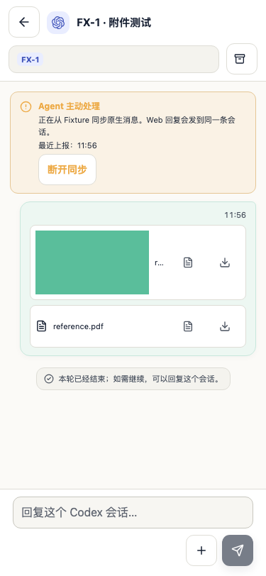
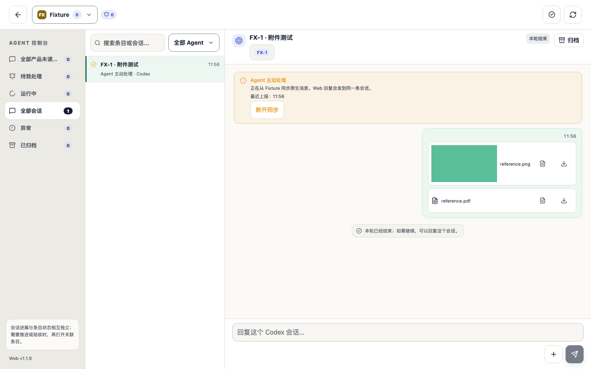
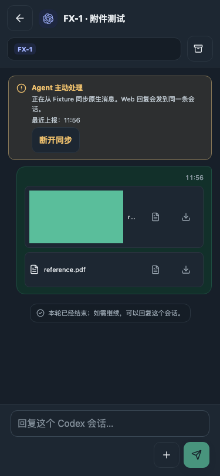
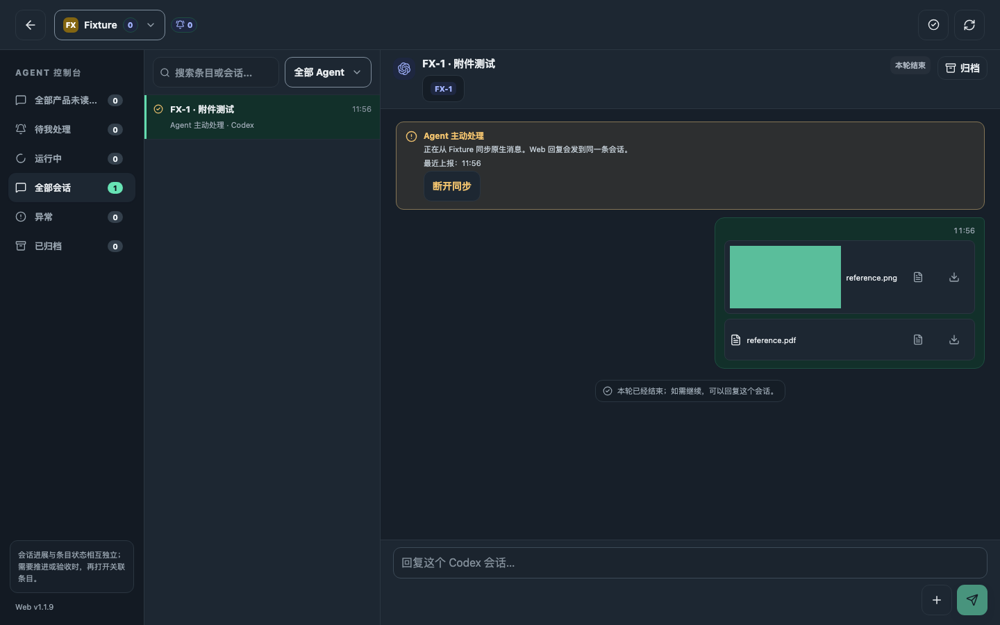

# AND-363 外部会话附件

由 `external-attachments.audit.spec.ts` 的合成会话生成；图片和 PDF 为测试数据，页面不连接实际 Agent。

| 375×812 | 1440×900 |
| --- | --- |
|  |  |
|  |  |

覆盖选择附件、纯附件发送、上传失败保留草稿并重试、历史图片实际解码与 PDF 附件、44px 上传入口及无横向溢出。三种 Agent 均经过相同明暗与宽度回归。真实模型读取效果留待实际环境验收。
