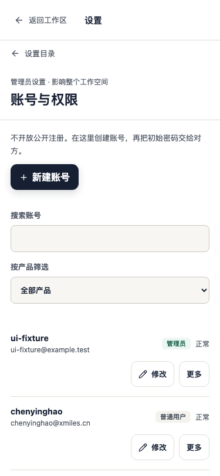
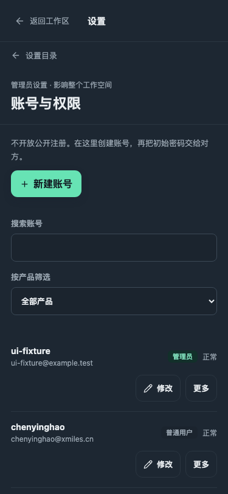
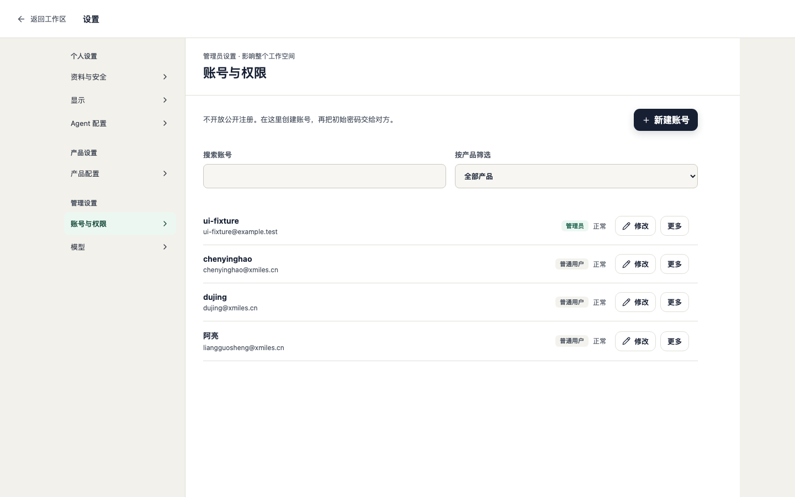
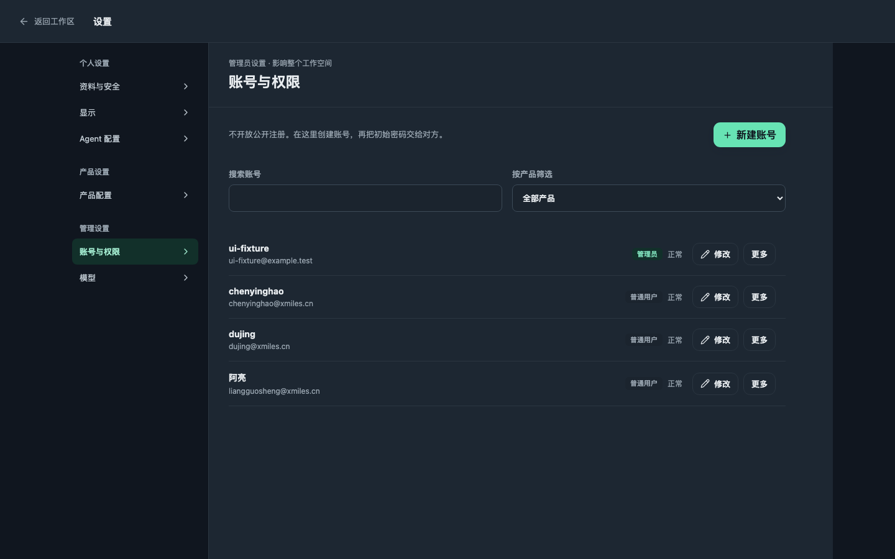

# 账号列表按姓名显示

四张截图均来自临时数据库中的合成账号，没有使用真实账号资料。

- 手机：375 × 812，浅色与深色。
- 桌面：1440 × 900，浅色与深色。
- 有昵称的账号（阿亮）把昵称放在第一行，没有昵称的账号（chenyinghao、dujing）把邮箱 @ 前面的部分放在第一行；完整邮箱始终在第二行。
- 身份标签（管理员 / 普通用户）移到右侧，与「正常」状态并列。
- 生成方式：临时 Playwright 用例创建账号、写入昵称后按上述四种视口截图；用例未提交。
- 同一界面已由 `tests/ui/settings-hierarchy.audit.spec.ts` 覆盖对比度、字号、横向溢出与 44px 触控尺寸检查，375 与 1440、浅色与深色各一轮，12/12 通过。

