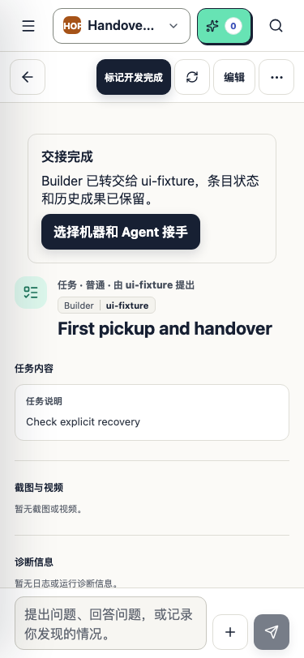
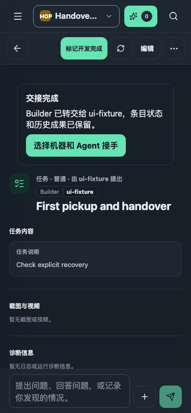
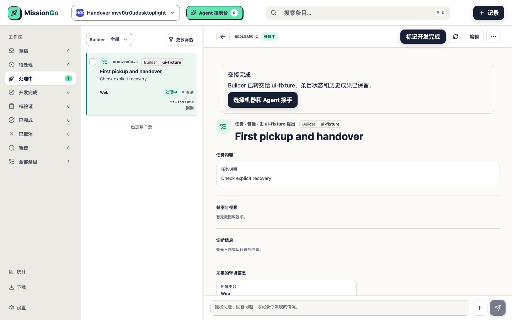
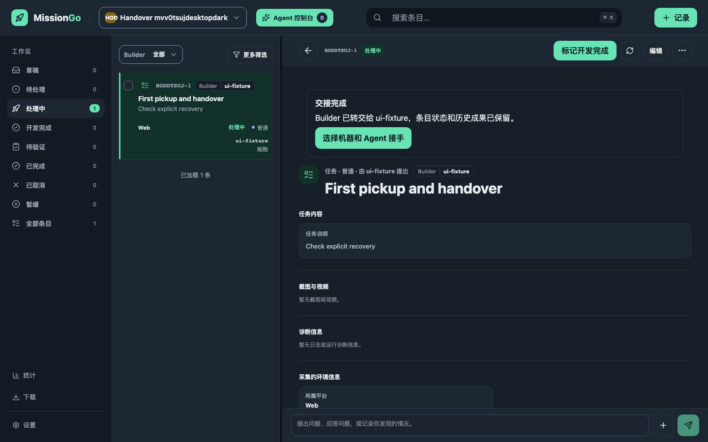

# Builder 执行权交接

截图来自临时数据库的合成条目，没有使用真实账号、条目或节点数据。

- 手机：375 × 812；桌面：1440 × 900，浅色和深色各一张。
- 展示交接完成后保留「处理中」状态，并由新 Builder 显式选择机器和 Agent 接手。
- `tests/ui/builder-handover.audit.spec.ts` 先通过真实 API 验证首次开始处理自动认领 Builder，再模拟交接进度响应验证受阻原因、手动重试、等待停止确认与接手按钮。模拟部分不能证明真实 Agent 已停止。
- `services/server/src/builder-handovers.test.ts` 覆盖真实服务端路由和持久化逻辑，包括停止回执、跨账户权限、执行凭据失效、旧合并/发布证据、并发与批量回滚。
- 浏览器断言覆盖新增按钮至少 44px 高、文字至少 11px、对比度至少 4.5:1，以及无横向溢出。
- 真机验收：使用两个具有产品操作与 AI 权限的账号，启动旧账号的单条目任务后转交；确认真实停止后才允许新账号派单，断网和失败时保持受阻，恢复后需手动重试。多条目会话应在任何取消或转交前被拦截。

