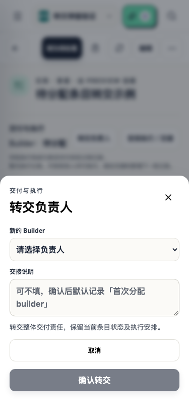
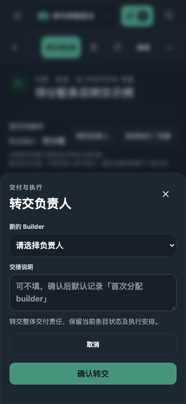
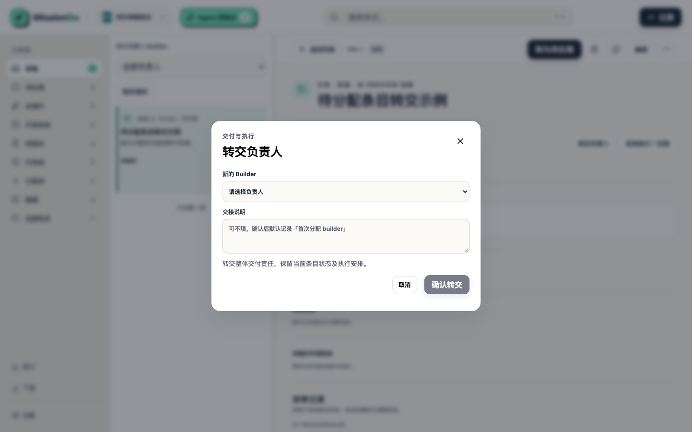
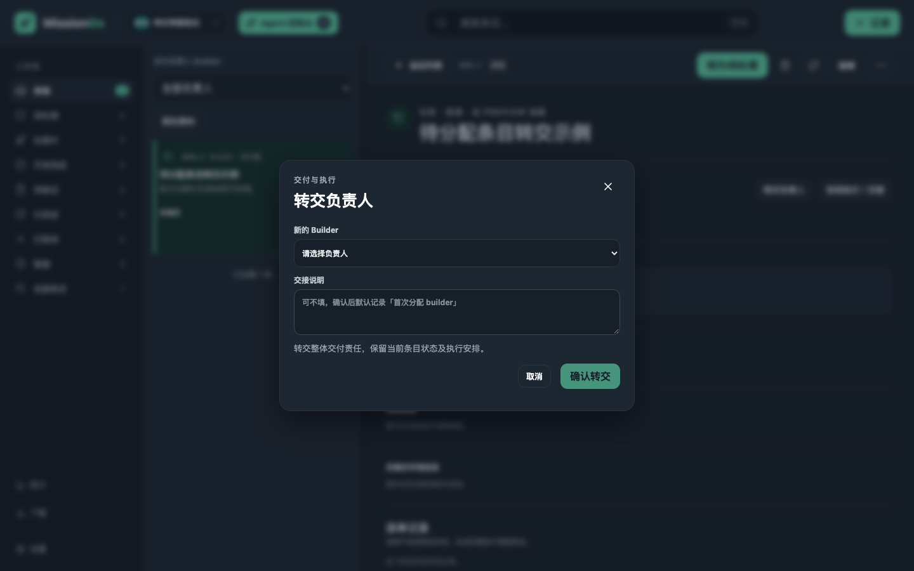

# 转交负责人弹窗

四张截图均来自临时数据库中的合成数据，没有使用真实条目。

- 手机：375 × 812，浅色与深色。
- 桌面：1440 × 900，浅色与深色。
- 展示「待分配」条目上的转交负责人弹窗：从无值到有值的首次分配时交接说明可留空，占位文案提示确认后默认记录「首次分配 builder」；既有负责人之间的真实转交仍要求必填。
- 「安排执行／交接」同样改为弹窗，与转交弹窗共用同一布局和底部操作区。
- 生成方式：临时 Playwright 脚本创建产品与条目、打开弹窗后按上述四种视口截图；脚本未提交。
- 同一界面已由 `tests/ui/builder-delivery.audit.spec.ts` 覆盖完整转交流程，375 与 1440、浅色与深色各一轮，4/4 通过。

