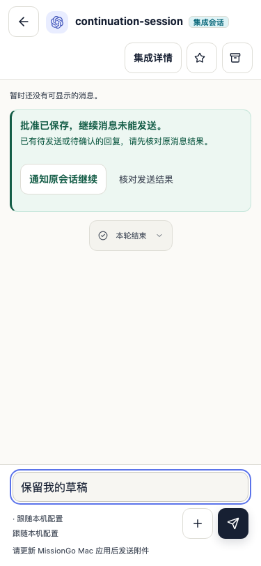
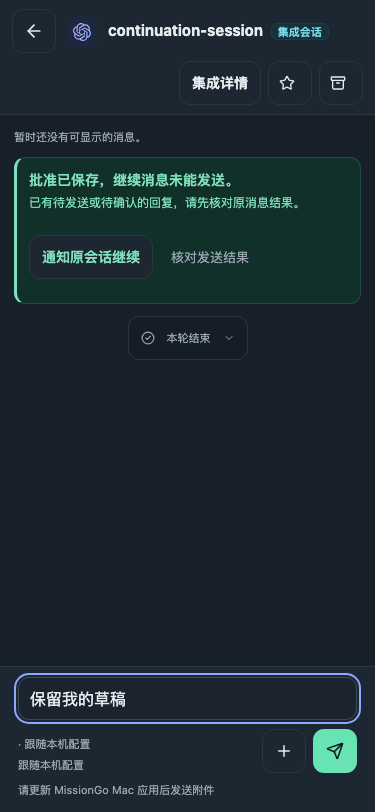
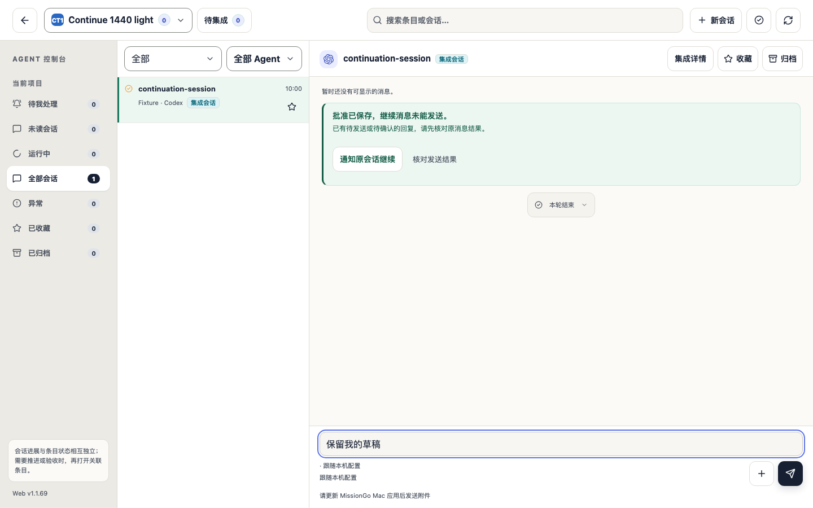
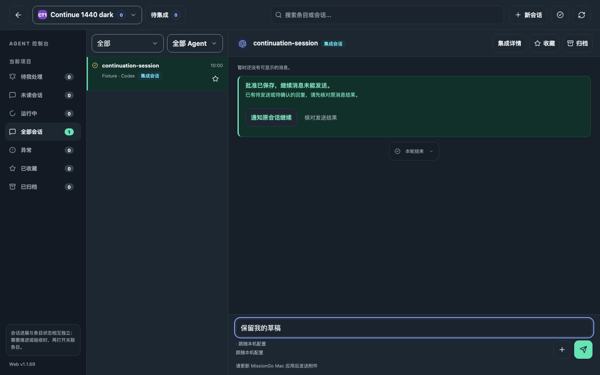

# 继续原会话：界面复核证据

截图来自最终代码的隔离浏览器回归，使用合成会话数据，非生产或真实 Android 设备截图。

覆盖 320px、375×812 与1440×900、明暗和三档字号；375 与桌面图用于 PR 审阅。13 个界面回归通过，包括成功回执保留、旧批准并存、失败终态指引和读取竞态。触控、字号与对比度沿用共用按钮和主题令牌，无样式豁免扩张；真机效果仍待验证。

| 375×812 浅色 | 375×812 深色 |
|---|---|
|  |  |

| 1440×900 浅色 | 1440×900 深色 |
|---|---|
|  |  |
