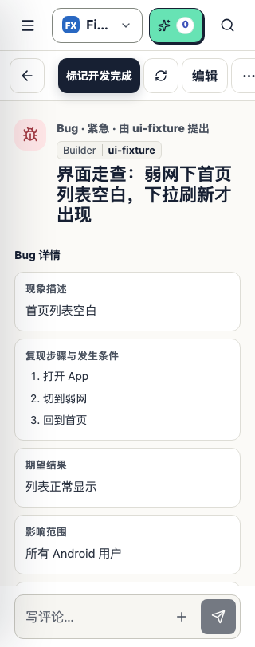

# 2026-10 UI/UE 审计证据

基线 `d395954`，本机 Chromium，独立临时实例与合成数据。对应[审计报告](../../ui-ue-audit-2026-10.md)。这些是缺陷证据，不是已修复基线。

| 文件 | 内容 |
|---|---|
| `observations.json` | 预览/Select 返回前后 URL、历史标记及焦点；大字号布局探针 |
| `layout-measurements.json` | 320px 三档字号的五个可见工具栏控件边界；只取顶层控件，排除关闭菜单的布局数据 |
| `media-before.png` / `media-after.png` | 图片预览按返回后直接退出详情 |
| `item-preview.png` | 预览已打开，Tab 焦点仍落在遮罩后的“归档”按钮 |
| `artifact-after.png` | 返回已消费会话历史层，文件预览仍打开 |
| `toolbar-320-medium.png` / `toolbar-320-large.png` / `toolbar-320-small.png` | 默认字号、大字号、小字号对照；大字号“更多操作”右边界约 334px |
| `detail-1440-dark.png` | 桌面大字号暗色详情的人工检查样本 |

复现步骤、源码位置、优先级与验收要求见报告 UIA-01～04。焦点和历史行为不能只靠静态截图证明，请结合 JSON 和复现步骤。

